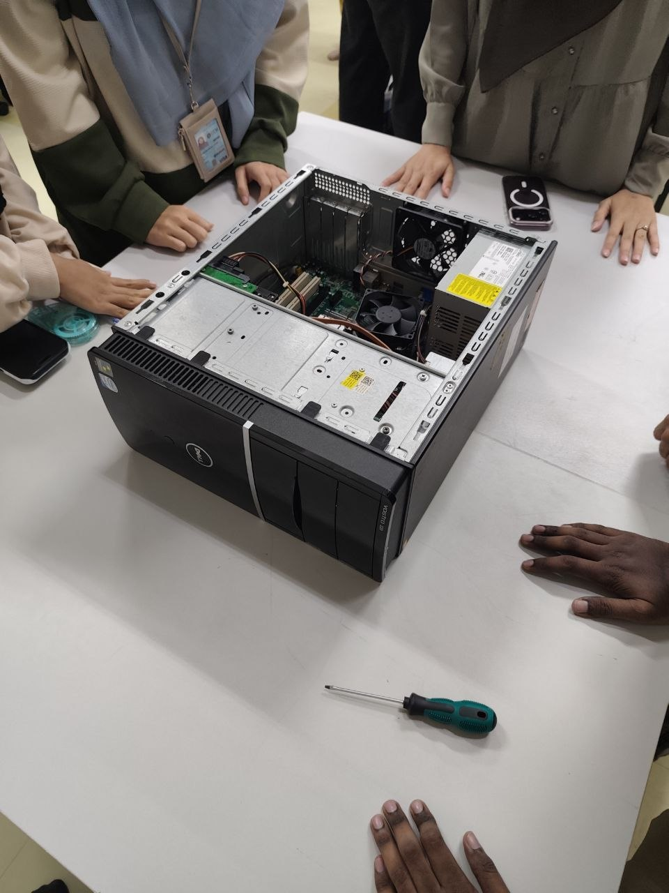
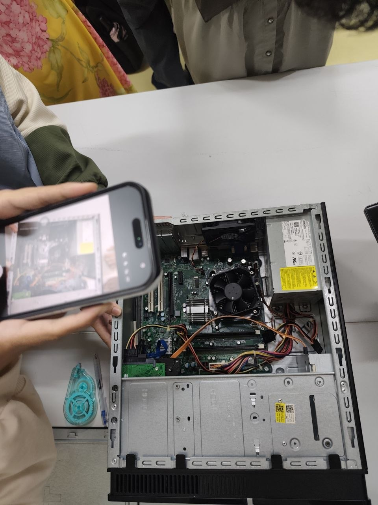
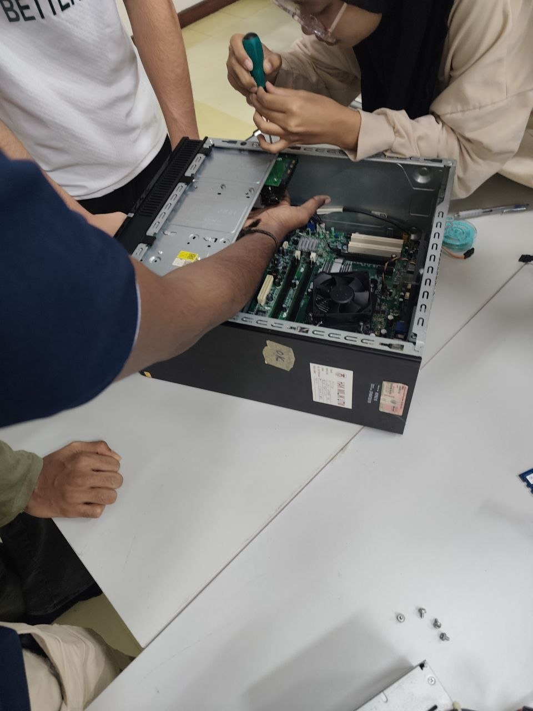

# 🖥️ PC Assembly and Disassembly Lab

## 1. Lab Overview

As part of the SECP1513 – Technology and Information System course at Universiti Teknologi Malaysia (UTM), I participated in a hands-on PC Assembly Lab session.

The activity was conducted in groups and focused on learning how to disassemble a desktop computer, identify its internal hardware components, and reassemble the computer after completing the practical tasks.

This session provided practical exposure to computer hardware and helped me understand how different components are installed and connected inside a desktop computer.

**Lab Details:**
- **Activity:** PC Assembly and Disassembly
- **Date:** 4 November 2026 (Wednesday)
- **Time:** 3:00 PM – 4:00 PM
- **Venue:** BK 10, Room 412-01, Level 4, N28
- **Course:** SECP1513 – Technology and Information System
- **Activity Type:** Group Practical Session

## 2. Objectives

The objectives of this laboratory activity were to:

- Understand the internal structure of a desktop computer.
- Identify important computer hardware components.
- Learn how to remove and reconnect internal computer components.
- Understand the basic procedures involved in PC disassembly and reassembly.
- Gain practical experience in handling computer hardware.

## 3. PC Disassembly and Reassembly Procedures

During the practical session, we followed these steps under the guidance of our instructor:

**Step 1: Opening the Computer Case**

We started by removing the side cover of the desktop computer to access its internal hardware components.

**Step 2: Disconnecting Internal Cables**

We disconnected the internal wires and cables connected to the computer components before removing the hardware.

**Step 3: Removing the Power Supply Unit (PSU)**

We unscrewed and carefully removed the power supply unit from the computer case.

**Step 4: Removing and Cleaning the RAM**

We removed the RAM modules from their slots. We were taught to clean the RAM contacts using an eraser before putting them back.

**Step 5: Removing the Hard Disk Drive (HDD)**

We unscrewed and removed the hard disk drive from its mounting position inside the computer case.

**Step 6: Removing the Cooling Fan**

We unscrewed and removed the cooling fan to understand its position and function inside the computer.

**Step 7: Reassembling and Testing the Computer**

After completing the disassembly process, we reinstalled all the removed components, secured the screws and reconnected the internal cables. Once everything was in place, we connected the computer to a monitor and turned it on to check whether it powered up successfully. This final test helped us confirm that the computer was properly reassembled and functioning.

## 4. Practical Session Documentation

The following photographs were taken during the laboratory activity as evidence of participation.

### Photo 1: Opening the Computer Case

The desktop computer case was opened to expose its internal components before starting the disassembly process.

### Photo 2: Identifying Internal Components

We examined the motherboard, RAM, power supply, cooling fan, storage drive and internal cables.

### Photo 3: Removing Computer Components

Our group worked together to remove the internal hardware components using appropriate tools, including a screwdriver.

## 5. Learning Outcomes

Through this practical activity, I gained a better understanding of desktop computer hardware and its internal structure.

Some of the important things I learned include:

- Identifying the main hardware components inside a desktop computer.
- Understanding the functions of the RAM, hard disk drive, power supply and cooling fan.
- Learning how internal cables connect different hardware components.
- Understanding the basic process of disassembling and reassembling a computer.
- Developing practical hardware-handling and teamwork skills.

## 6. Challenges Encountered

One of the challenges during this activity was identifying the different internal cables and understanding where each component was connected.

Handling and removing hardware components also required care to avoid damaging the components or their connections.

Working as a group helped us share responsibilities and learn from one another throughout the activity.

## 7. Personal Reflection

This PC Assembly Lab was a valuable hands-on learning experience because it allowed me to explore the internal structure of a desktop computer rather than learning about hardware components through theory alone.

Before participating in this activity, I mainly understood computer hardware through classroom explanations. However, having the opportunity to open the computer case, disconnect the cables, remove the RAM, power supply, hard disk and cooling fan helped me develop a clearer understanding of how these components are arranged and connected.

I also learned the importance of handling computer hardware carefully and following the correct procedures during disassembly and reassembly.

As a Computer Science student specialising in Computer Networks and Security, I believe this knowledge provides a useful foundation for understanding computer systems and hardware troubleshooting.

Overall, this activity improved my practical knowledge, teamwork and confidence in handling basic computer hardware.

## 8. Suggestions for Improvement

For future laboratory sessions, I suggest providing a more detailed hardware identification guide and allowing students additional hands-on practice with different computer models.

It would also be useful to demonstrate proper electrostatic discharge (ESD) precautions and safe hardware-cleaning techniques before handling sensitive components.

This could help students develop better hardware-handling skills and understand the importance of protecting computer components during maintenance.

## 9. Conclusion

In conclusion, the PC Assembly Lab provided valuable practical experience in understanding computer hardware through disassembly and reassembly.

The activity strengthened my knowledge of internal computer components and allowed me to apply theoretical concepts in a real laboratory environment.
